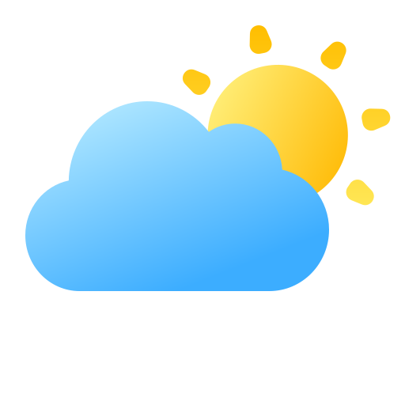
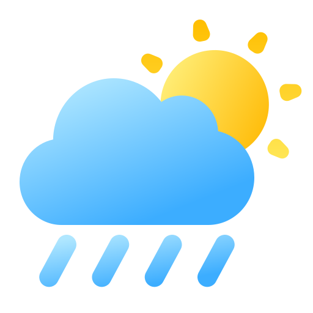

<div align="center">

  

  <br />

  <h3>🌤️ Previsão Meteorológica Inteligente em Tempo Real</h3>

  <p>
    <strong>Uma experiência meteorológica de alta precisão, desenvolvida com React 18, TypeScript, Tailwind CSS e Arquitetura de Contingência Tripla.</strong>
  </p>

  <p>
    <a href="https://react.dev/"></a>
    <a href="https://www.typescriptlang.org/"></a>
    <a href="https://vitejs.dev/"></a>
    <a href="https://tailwindcss.com/"></a>
    <a href="https://tanstack.com/query/latest"></a>
    <a href="https://recharts.org/"></a>
    <a href="LICENSE"></a>
  </p>

  <p>
    <a href="#-principais-recursos">Recursos</a> •
    <a href="#-arquitetura-de-failover-em-3-camadas">Arquitetura de Contingência</a> •
    <a href="#-telas-e-mockups">Mapa de Telas</a> •
    <a href="#-instala%C3%A7%C3%A3o-e-execu%C3%A7%C3%A3o">Como Rodar</a> •
    <a href="#-autoria-e-cr%C3%A9ditos">Créditos</a>
  </p>

</div>

---

## 🌟 Visão Geral

O **OCLIMA** redefine a forma de consultar e compartilhar previsões meteorológicas na web. Com uma interface moderna inspirada nos mais refinados padrões de design (*Glassmorphism, Apple Weather e Linear*), a aplicação combina **alta precisão via satélite**, **resiliência absoluta contra falhas de API** e **geração instantânea de fotos para compartilhamento em redes sociais**.

---

## 🚀 Principais Recursos

### 📸 Compartilhamento com Foto em Tempo Real
- Gera uma fotografia nítida (PNG 2x de resolução) do clima atual da cidade consultada.
- Envio direto para **WhatsApp** com mensagem formatada e link.
- Botão de download rápido da foto e suporte a compartilhamento nativo no celular (*Web Share API*).

### ⚡ Arquitetura de Contingência Tripla (3-Tier Failover)
- A aplicação **nunca quebra**: se uma API falhar, cair ou estourar a cota, a próxima assume instantaneamente e de forma transparente para o usuário.

### 📊 Curva Térmica e Gráficos Fluidos de 24 Horas
- Gráfico contínuo (*AreaChart*) com interpolação natural, degradê luminoso e indicador de pico térmico.
- Carrossel inferior com 8 intervalos de 3 horas com ícones 3D dedicados.

### 🌡️ Previsão de 5 Dias com Amplitude Térmica
- Barras horizontais dinâmicas de temperatura (estilo Apple Weather) que ilustram visualmente a mínima e a máxima de cada dia em relação à semana inteira.

### 🧭 Widgets Atmosféricos Avançados
- **Ciclo Solar:** Arco de luz do dia com percentual decorrido e horários de nascer e pôr do sol.
- **Bússola Dinâmica:** Agulha com rotação real baseada no ângulo exato do vento e classificação de intensidade.
- **Barômetro:** Manômetro visual de pressão atmosférica em hPa.
- **Conforto Térmico:** Medidor de umidade relativa com barra visual.

### ⭐ Favoritos Persistentes sem Necessidade de Login
- Salve suas cidades favoritas com **1 clique** diretamente no card.
- Dados persistidos com segurança no `localStorage` do seu próprio navegador.

### 🔍 Busca Global Acessível (Command Palette)
- Atalho global de teclado: pressione **`Ctrl + K`** (ou `⌘K`) de qualquer lugar da tela.
- Histórico de buscas recentes com data/hora e atalhos rápidos.

---

## 🛡️ Arquitetura de Failover em 3 Camadas

O OCLIMA implementa uma esteira de dados orquestrada em 3 níveis de redundância:

```text
                                 ┌────────────────────────┐
                                 │  REQUISIÇÃO DO USUÁRIO │
                                 └───────────┬────────────┘
                                             │
                                             ▼
                      ┌──────────────────────────────────────────────┐
                      │ 1º NÍVEL: WeatherAPI.com (Principal)         │
                      │ • 1.000.000 requisições/mês gratuitas        │
                      │ • Dados ao vivo via satélite em tempo real   │
                      └──────────────────────┬───────────────────────┘
                                             │ [Em caso de erro / cota]
                                             ▼
                      ┌──────────────────────────────────────────────┐
                      │ 2º NÍVEL: OpenWeatherMap (Failover 1)        │
                      │ • 1.000 requisições/dia                      │
                      │ • Padrão global de meteorologia              │
                      └──────────────────────┬───────────────────────┘
                                             │ [Em caso de falha de conexão]
                                             ▼
                      ┌──────────────────────────────────────────────┐
                      │ 3º NÍVEL: Open-Meteo & Intelligent Mock      │
                      │ • 100% gratuito sem chave de API necessária  │
                      │ • Fallback offline com dados realistas       │
                      │ • GARANTIA: O app NUNCA exibe tela quebrada  │
                      └──────────────────────────────────────────────┘
```

---

## 🎨 Pacote de Ícones 3D Homogêneos

Cada condição climática possui sua ilustração própria renderizada em alta definição (512×512) com transparência e iluminação 3D volumétrica:

<div align="center">
  <table>
    <tr>
      <td align="center"><br/><b>Ensolarado</b></td>
      <td align="center"><br/><b>Sol c/ Nuvens</b></td>
      <td align="center"><br/><b>Encoberto</b></td>
      <td align="center"><br/><b>Garoa / Chuvisco</b></td>
      <td align="center"><br/><b>Chuva / Pancadas</b></td>
      <td align="center"><br/><b>Tempestade</b></td>
      <td align="center"><br/><b>Nevoeiro</b></td>
      <td align="center"><br/><b>Noite Limpa</b></td>
    </tr>
  </table>
</div>

---

## 🗺️ Telas e Mockups do Sistema

Acesse a rota interativa **`/mockup`** para visualizar as especificações e wireframes de todas as páginas:

| Tela | Rota | Descrição |
|:---|:---|:---|
| **Dashboard Principal** | `/` | Clima ao vivo, radar de localização, gráficos de 24h, condições atmosféricas e carrossel de favoritos. |
| **Página da Cidade** | `/city/:cityName?lat=...&lon=...` | Consulta aprofundada de qualquer cidade do mundo com botão de favoritar e métricas completas. |
| **Busca & Autocomplete** | `Ctrl + K` / Modal | Busca rápida mundial com sugestões em tempo real e histórico de pesquisas. |
| **Página 404 Interativa** | `*` / `/404` | Tela temática com nuvens animadas e contador de redirecionamento automático em 10 segundos. |
| **Guia & Design System** | `/mockup` | Documentação visual de tokens, cores, tipografia e componentes. |

---

## 💻 Stack Tecnológica Completa

| Categoria | Tecnologia | Finalidade |
|:---|:---|:---|
| **Linguagem & Runtime** | [TypeScript 5.6](https://www.typescriptlang.org/) + [React 18.3](https://react.dev/) | Tipagem estrita e renderização reativa |
| **Build & Bundler** | [Vite 5.4](https://vitejs.dev/) | Compilação ultrarrápida com manual chunk splitting |
| **Estilização** | [Tailwind CSS 3.4](https://tailwindcss.com/) + [tailwindcss-animate](https://github.com/jamiebuilds/tailwindcss-animate) | Design responsivo, moderno e animações fluidas |
| **Componentes UI** | [Radix UI](https://www.radix-ui.com/) + [Shadcn UI](https://ui.shadcn.com/) | Acessibilidade nativa e componentes headless |
| **Gerenciamento de Estado**| [TanStack React Query v5](https://tanstack.com/query) | Cache assíncrono, invalidação e sincronização |
| **Visualização de Dados** | [Recharts 2.13](https://recharts.org/) | Curva de temperatura contínua e tooltips responsivos |
| **Captura de Imagem** | [html-to-image](https://github.com/bubkoo/html-to-image) | Renderização de canvas e PNG HD para compartilhamento |
| **Notificações** | [Sonner](https://sonner.emilkowal.ski/) | Toasts informativos e elegantes |
| **Ícones** | [Lucide React](https://lucide.dev/) | Ícones vetoriais modernos |

---

## 🛠️ Instalação e Execução

### 1. Clonar o Repositório
```bash
git clone https://github.com/LinkjohnDEV/OCLIMA.git
cd OCLIMA
```

### 2. Instalar as Dependências
```bash
npm install
```

### 3. Configurar Variáveis de Ambiente
Copie o modelo de ambiente:
```bash
cp .env.example .env
```

Configure suas chaves (o sistema já possui fallback automático caso nenhuma chave seja inserida):
```env
# 1º Provedor (Principal): WeatherAPI.com
VITE_WEATHERAPI_KEY=sua_chave_weatherapi_aqui
VITE_WEATHERAPI_BASE_URL=https://api.weatherapi.com/v1

# 2º Provedor (Failover 1): OpenWeatherMap
VITE_OPENWEATHER_API_KEY=sua_chave_openweather_aqui
VITE_API_BASE_URL=https://api.openweathermap.org/data/2.5
VITE_API_GEO_URL=https://api.openweathermap.org/geo/1.0
VITE_API_UNITS=metric
```

### 4. Executar em Modo de Desenvolvimento
```bash
npm run dev
```
Acesse `http://localhost:5173` no seu navegador.

### 5. Compilar para Produção (Build)
```bash
npm run build
```

---

## 📦 Estrutura do Código

```text
OCLIMA/
├── public/                 # Imagens, logotipo oficial, favicons e ícones 3D
│   ├── favicon/            # Favicons em todos os formatos (ico, png, svg, apple-touch)
│   ├── weather/            # Pacote de ícones 3D por categoria de tempo
│   └── logo.png            # Logotipo oficial transparente
├── src/
│   ├── api/                # Clientes meteorológicos e motor de failover
│   │   ├── config.ts       # Endpoints e chaves de provedores
│   │   ├── types.ts        # Tipagens estritas de clima e coordenadas
│   │   ├── weather.ts      # Cliente orquestrador dos 3 provedores
│   │   └── mock-weather.ts # Dados de fallback realistas
│   ├── components/         # Componentes visuais
│   │   ├── current-weather.tsx      # Card principal com glassmorphism e favoritos
│   │   ├── hourly-temprature.tsx    # Gráfico contínuo de 24h e tira de horários
│   │   ├── weather-forecast.tsx     # Previsão de 5 dias com amplitude térmica
│   │   ├── weather-details.tsx      # Widgets atmosféricos (Sol, Vento, Barômetro)
│   │   ├── share-weather-dialog.tsx # Modal de compartilhamento com foto e link
│   │   ├── favorite-cities.tsx      # Carrossel de acesso rápido a favoritos
│   │   ├── city-search.tsx          # Busca global com atalho Ctrl+K
│   │   └── header.tsx               # Barra de navegação com logo oficial
│   ├── hooks/              # Custom hooks (useWeather, useFavorites, useGeolocation)
│   ├── pages/              # Páginas da aplicação (Dashboard, City, Mockup, 404)
│   ├── App.tsx             # Roteador e Provedores Globais
│   └── main.tsx            # Ponto de entrada da aplicação
├── index.html              # HTML com SEO, metadados e favicons configurados
└── vite.config.ts          # Configuração do Vite com chunk splitting
```

---

## 👩‍💻 Autoria e Créditos

Desenvolvido e mantido por **[Lauren ia](https://ialauren.com)**.

> *"A tecnologia deve ser tão elegante e previsível quanto a própria natureza."*

---

## 📄 Licença

Este projeto é distribuído sob os termos da licença **MIT**. Consulte o arquivo [LICENSE](LICENSE) para obter mais detalhes.
